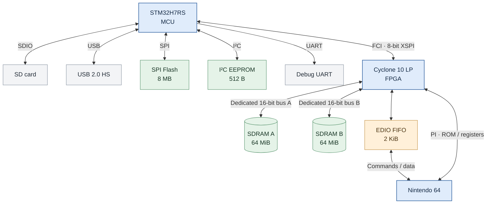

# EverDrive-64 PRO — Developer Reference

Hardware interfaces and programming API for the EverDrive-64 PRO cartridge. Function signatures and constants correspond to [`everdrive.c`](https://github.com/krikzz/ed64-pro-pub/blob/main/edio/everdrive.c) and [`everdrive.h`](https://github.com/krikzz/ed64-pro-pub/blob/main/edio/everdrive.h).

## 1. Hardware overview

| Component | Implementation / role |
|---|---|
| Main MCU | STM32H7RS; executes commands, manages SD, USB and cartridge services |
| FPGA | Intel Cyclone 10 LP `10CL016YU256C8G`; N64 cartridge interface, memory mapping, registers |
| SDRAM | Two 64 MiB SDRAM devices (128 MiB total), **each connected to the FPGA through its own dedicated 16-bit bus** |
| SPI Flash | 8 MB; stores cartridge firmware |
| I²C EEPROM | 512 bytes; stores operating statistics |
| CIC | Separate STM32-based, firmware-updatable CIC implementation |
| SD card | 4-bit SDIO through MCU; up to approximately 25 MB/s |
| USB | High-speed USB through MCU; 480 Mbit/s |
| FCI | 8-bit XSPI-based interconnect between MCU and FPGA; accesses FPGA configuration, registers and memory |
| Debug | On-board 3-pin UART, 921600 baud |

The N64 interfaces with the FPGA through the cartridge bus. The MCU processes commands and controls SD, USB and other peripherals. The MCU accesses FPGA registers and SDRAM over FCI. Commands are accepted through the N64 FIFO or USB; both interfaces use the same command format. The [edlink](https://github.com/krikzz/edlink) utility implements the PC-side interface.

### Block diagram



### Memory map

FCI addresses identify MCU-accessible SDRAM and registers. PI addresses identify N64-accessible cartridge regions. 

| FCI address | Purpose |
|---|---|
| `0x00000000` | ROM/SDRAM window (`ADDR_FCI_ROM`) |
| `0x0F000000` | Save-state buffer, also visible via PI at `0x1F000000` |
| `0x0F800000` | 64DD IPL4 ROM (`ADDR_FCI_IPL4`) |
| `0x0FF00000` | Cartridge menu ROM (`ADDR_FCI_MENU`) |
| `0x0FFE0000` | Backup RAM storage area (inside the upper menu-region address range) |
| `0x10000000` | FPGA registers (`ADDR_FCI_SYS`) |
| `0x10010000` | MCU FIFO (`ADDR_FCI_FIFO`) |
| `0x10020000` | MCU FIFO read-available register (`ADDR_FCI_FAVB`); number of bytes the MCU can read from the FIFO |
| `0x10030000` | Mailbox (`ADDR_FCI_MBX`) |

| PI address | Purpose |
|---|---|
| `0x10000000` | Game ROM window (`ADDR_PI_ROM`) |
| `0x1F000000` | Save-state buffer |
| `0x1F800000` | Cartridge I/O registers (`EDIO_BASE`) |

`SIZE_RAM = 0x10000000` defines a **256 MiB FCI SDRAM window**. The installed **128 MiB SDRAM is mirrored** across this window: `0x08000000` maps to the same SDRAM location as `0x00000000`. `0x10000000` is outside the SDRAM window and selects FPGA registers (`ADDR_FCI_SYS`).

## 2. N64 register interface

`EDIO` defines 32-bit registers at N64 uncached address `0xBF800000` (`KSEG1 | 0x1F800000`).

| Offset | Register | Access | Meaning |
|---|---|---|---|
| `0x00` | `EDIO->FIFODATA` | R/W | MCU command/data FIFO, **one payload byte per 32-bit word** (low 8 bits) |
| `0x04` | `EDIO->FIFOSTAT` | R | Low 16 bits: number of bytes available for reading |
| `0x08` | `EDIO->SYSSTAT` | R/W | MCU/FPGA state and validity indicators |
| `0x0C` | `EDIO->TIMER` | R | Free-running, 32-bit milliseconds since FPGA start |
| `0x10` | `EDIO->MBX` | R/W | Shared 32-bit mailbox for N64, MCU and USB-side code |
| `0x14` | `EDIO->EDID` | R | `0xED6400xx`; device ID `xx = 0x27` (`DEVID_ED64PRO`) for ED64 PRO |
| `0x18` | `EDIO->MCTR` | R/W | 50 MHz counter; write to reset to zero |

`SYSSTAT` fields:

| Bits | Symbol | Meaning |
|---|---|---|
| 0 | `SYSSTAT_BUSY` | MCU processing a command or has pending FIFO commands |
| 1 | `SYSSTAT_WAIT_MCU` | Set to wait for MCU command completion; MCU clears it |
| 2 | `SYSSTAT_WAIT_FPG` | Set to wait for FPGA reconfiguration; clears when ready |
| 3 | `SYSSTAT_STROBE` | Toggles after each read of `SYSSTAT` |
| 7:4 | `SYSSTAT_CMSK` / `SYSSTAT_CVAL` | `(status & 0xF0) == 0xA0` on a valid response |
| 16 | `SYSSTAT_BTN` | Current state of the on-board cartridge button |

During FPGA reconfiguration, PI register reads may return open-bus data. FPGA response validation uses `SYSSTAT_CVAL` and the changing `SYSSTAT_STROBE` bit.

### FIFO and PI DMA characteristics

- FIFO capacity is **2 KiB**. For the N64 side `EPO_TYPE_LINK` transfers pass through the FIFO and require controlled block sizes. `EPO_TYPE_LINK_ACK` provides 1 KiB block acknowledgment. The total transfer length is not limited to 1 KiB.
- When doing PI DMA to/from an `EDIO` register, the FPGA **holds the register address** throughout a burst. Each consecutive 32-bit transfer accesses that same register instead of incrementing to the next one.
- The N64 PI controller can issue a new cartridge address after **512 bytes (256 × 16-bit words)** or earlier for unfavorable RDRAM alignment. A new address may no longer select the intended register.
- `ed_reg_rd_stream()` / `ed_reg_wr_stream()` handle this by using an aligned 512-byte DMA buffer. Each DMA transfer conveys up to **128 FIFO bytes** (one byte in each 32-bit word).
- PI DMA buffers require correct alignment and cache coherency on the N64.

## 3. Command and transfer model

Commands are transmitted through `EDIO->FIFODATA` in two formats: **CMD** (without subcommand) and **SCMD** (with subcommand).

```text
CMD:  [0x2B] [0xD4] [CMD] [CMD ^ 0xFF] [PAYLOAD]
SCMD: [0x2B] [0xD4] [CMD] [CMD ^ 0xFF] [SUBCMD] [PAYLOAD]
```

`PAYLOAD` is command-specific and may be empty. Strings are encoded as a 16-bit byte length followed by raw bytes without a trailing NUL.

| Command group | Opcode | Function |
|---|---|---|
| `CMD_FS` | `0x80` | Filesystem and directory operations |
| `CMD_EPO` | `0x81` | Transfers between data endpoints |
| `CMD_FCI` | `0x82` | FCI mapped memory operations: fill, test, CRC |
| `CMD_RTC` | `0x83` | Real-time clock and calibration |
| `CMD_SYS` | `0x84` | System information, reset and firmware maintenance |
| `CMD_DEV` | `0x85` | Game configuration, cartridge services and backup memory |
| `CMD_BOOT` | `0xF0` | Bootloader and security services |

Standalone commands:

| Command | Opcode | Function |
|---|---|---|
| `CMD_STATUS` | `0x10` | Read command status |
| `CMD_GET_MODE` | `0x11` | Determine whether the MCU is running in normal or recovery mode |
| `CMD_IO_RST` | `0x12` | Reset command interface |
| `CMD_NRESP` | `0x13` | Read extended error code |

An EPO transfer specifies source endpoint, destination endpoint, addresses and byte count:

```c
typedef struct {
    u32 src_addr;
    u32 dst_addr;
    u32 len;
    u8 src_type;
    u8 dst_type;
    u16 reserved;
} EpoXfer;
```

| Endpoint type | Value | Description |
|---|---|---|
| `EPO_TYPE_LINK` | `0x10` | Requesting transport: N64 FIFO or PC USB |
| `EPO_TYPE_LINK_ACK` | `0x11` | Requesting transport, flow-controlled in 1 KiB blocks |
| `EPO_TYPE_FS` | `0x12` | Currently open file |
| `EPO_TYPE_FCI` | `0x13` | FCI-mapped SDRAM and registers |
| `EPO_TYPE_FLA` | `0x14` | External SPI flash containing firmware/configuration data; writes may overwrite system data |
| `EPO_TYPE_RAM` | `0x15` | MCU-private buffer; not an external endpoint |
| `EPO_TYPE_NOP` | `0x16` | Reads zero, discards writes |
| `EPO_TYPE_DBG` | `0x17` | Debug UART |
| `EPO_TYPE_USB` | `0x18` | Direct USB endpoint |
| `EPO_TYPE_SDC` | `0x19` | Raw SD sectors |

`ed_fs_file_read()` transfers `EPO_TYPE_FS → EPO_TYPE_LINK_ACK` via N64 FIFO. `ed_fs_file_read_fci()` transfers `EPO_TYPE_FS → EPO_TYPE_FCI` directly without FIFO buffering. FCI transfers have no 1 KiB block-size restriction; FIFO flow control applies to transfers involving `EPO_TYPE_LINK`.

### Command completion and errors

Unless otherwise specified, `u8` status functions return `0` on success and nonzero on failure. `ed_check_status()` sends `CMD_STATUS` and receives four bytes:

```text
[0] 0x5A          STATUS_KEY
[1] 0x07          Protocol ID on ED64 family
[2] 0x27          Device ID on ED64 PRO
[3] status        0 = success; otherwise error category
```

`ed_cmd_nresp(status)` retrieves a more specific error subcode for that category. Functions returning data or `void` are identified in the API tables. FIFO and mailbox waits do not have timeouts.

The mailbox can carry any 32-bit value. The MCU writes `MBX_READY` (`0x52445921`) upon completion of **stop**, **reset** and **FPGA initialization**; the corresponding library methods use it for synchronization. `MBX_NOP = 0`; `MBX_SST_EXIT = 0xED640001` is also defined.

## 4. Initialization and common workflow

Initialization and game-launch sequence:

1. Confirm that the cartridge ID matches the expected hardware (`ed_get_cart_id()`).
2. Call `ed_init_hw()` to stop active device handlers and flush stale FIFO data; check its return code.
3. Open files and transfer data (use `*_fci` for cartridge SDRAM). If file access fails, call `ed_fs_init()` to reinitialize the SD card/filesystem and retry the operation.
4. To launch a game, load its ROM image, set the required paths and **populate `DevCfg` according to the game configuration** (ROM, save type/size, RTC, 64DD and other applicable settings). Call `ed_dev_set_cfg()`, then `ed_dev_start()`.
5. Transfer CPU execution using N64 boot/reset code. **`ed_dev_start()` configures the cartridge; it does not jump to the loaded game.**

The MCU provides background backup RAM, RTC and 64DD services during game execution. `ed_dev_stop()` stops these services and restores the default cartridge configuration.

### Custom menu

To install a custom cartridge menu, copy the menu ROM to `ed64/menu.n64` on the SD card.

## 5. API reference (`everdrive.h`)

Signatures below match the supplied header; `addr` in `*_fci` routines is an **FCI address**, not a CPU pointer. Except where indicated, lengths are **bytes**.

### 5.1 Device, FIFO and diagnostics

| Function | Behavior / return |
|---|---|
| `u8 ed_init_hw()` | Stop device and flush FIFO; returns error status |
| `u32 ed_get_cart_id()` | Read complete `EDID` register (`0xED640027` on PRO) |
| `u32 ed_fifo_avb()` | Number of bytes currently readable from FIFO |
| `void ed_fifo_flush()` | Consume available FIFO data |
| `u32 ed_fifo_rda(void *dst, u32 len)` | Nonblocking FIFO read, at most `len`; returns bytes received |
| `void ed_fifo_rd(void *dst, u32 len)` | Blocking read of exactly `len` bytes |
| `void ed_rx_string(u8 *string)` | Read length-prefixed string and NUL-terminate; `NULL` discards the string |
| `u8 ed_check_status()` | Read last-command status; returns 0, or MCU error code |
| `u8 ed_cmd_nresp(u8 resp)` | Return detailed subcode of MCU error category `resp` |
| `u8 ed_usb_wr(void *src, u32 len)` | Send N64 RAM bytes to cartridge USB endpoint |
| `u8 ed_usb_wr_fci(u32 src, u32 len)` | Send data from FCI memory directly to USB; special-use transfer |
| `u8 ed_urt_wr(u8 *src, u32 len)` | Send bytes to the on-board debug UART |
| `int ed_dbg_wr_usb(char *buf, unsigned int len)` | USB debug-output adapter; returns requested byte count |
| `int ed_dbg_wr_urt(char *buf, unsigned int len)` | UART debug-output adapter; returns requested byte count |
| `void ed_mbx_wr(MbxOp val)` | Write shared 32-bit mailbox |
| `u32 ed_mbx_rd()` | Read mailbox twice until two consecutive readings agree |
| `u32 ed_get_ticks()` | Read free-running FPGA timer in milliseconds |
| `double ed_measure_fps()` | Measure VI frame rate using the 50 MHz timer over five frames |

**Buffer safety:** `ed_rx_string()` does not accept a capacity. Supply a buffer large enough for the incoming string **plus its NUL terminator**. `ed_fifo_rd()` has no timeout. Debug/USB wrapper return values do not necessarily indicate actual transport completion.

### 5.2 Files and directories

File access uses the MCU filesystem (FatFs-derived error codes). `ed_fs_file_open()` selects the file subsequently used by sequential read/write/seek functions.

| Function | Behavior / return |
|---|---|
| `u8 ed_fs_init()` | Reinitialize SD media and filesystem after a file-access failure |
| `u8 ed_fs_file_open(u8 *path, u8 mode)` | Open file with combined `FA_*` flags; empty path is an error |
| `u8 ed_fs_file_close()` | Close open file; **required after writing** to commit data |
| `u32 ed_fs_file_available()` | Remaining readable bytes in current file |
| `u8 ed_fs_file_read(void *dst, u32 len)` | Read file to N64 RAM through ACK-controlled FIFO (slower) |
| `u8 ed_fs_file_read_fci(u32 addr, u32 len)` | Read file directly into cartridge SDRAM/FCI space (faster) |
| `u8 ed_fs_file_write(void *src, u32 len)` | Write N64 RAM data to file through ACK-controlled FIFO |
| `u8 ed_fs_file_write_fci(u32 addr, u32 len)` | Write data from FCI memory to file |
| `u8 ed_fs_file_set_ptr(u32 addr)` | Set byte offset for subsequent file I/O |
| `u8 ed_fs_file_info(u8 *path, FileInfo *inf)` | Obtain size, FAT time/date, directory attribute and name |
| `u8 ed_fs_file_del(u8 *path)` | Delete a file (also used for directories in the menu wrappers) |
| `u8 ed_fs_file_crc(u32 len, u32 *crc_base)` | CRC32 of `len` file bytes from current pointer; `*crc_base` is input seed and output CRC |
| `u8 ed_fs_file_copy(u8 *src, u8 *dst, u8 dst_mode)` | Copy file; destination mode should include `FA_WRITE` |
| `u8 ed_fs_file_seek_pat(u8 *pat, u8 psize, u32 fsize, u32 *paddr)` | Search up to `fsize` bytes of open file for `psize`-byte pattern; returns status and stores byte offset in `*paddr` (0 if not found) |
| `u8 ed_fs_file_test(u8 *path)` | Return 0 if file exists; otherwise error |
| `u8 ed_fs_dir_test(u8 *path)` | Return 0 if directory exists; otherwise error |
| `u8 ed_fs_dir_make(u8 *path)` | Create directory |
| `u8 ed_fs_dir_load(u8 *path, u8 dir_opt)` | Load a directory listing using `DIR_OPT_*` flags |
| `void ed_fs_dir_get_size(u16 *size)` | Obtain entry count of loaded directory |
| `void ed_fs_dir_get_recs(u16 start_idx, u16 amount, u16 max_name_len)` | Request a batch of entries, optionally truncating transmitted names |
| `u8 ed_fs_rx_next_rec(FileInfo *inf)` | Receive one requested directory entry; repeat after `get_recs()` |

**Open modes**

| Flag | Value | Description |
|---|---|---|
| `FA_READ` | `0x01` | Read access |
| `FA_WRITE` | `0x02` | Write access |
| `FA_OPEN_EXISTING` | `0x00` | Open an existing file |
| `FA_CREATE_NEW` | `0x04` | Create a new file; fail if it exists |
| `FA_CREATE_ALWAYS` | `0x08` | Create a file or truncate an existing file |
| `FA_OPEN_ALWAYS` | `0x10` | Open an existing file or create a new one |
| `FA_OPEN_APPEND` | `0x30` | Open or create and seek to the end |
| `FS_MAKEPATH` | `0x80` | Create missing parent directories |

**Directory options**

| Flag | Value | Description |
|---|---|---|
| `DIR_OPT_SORTED` | `0x01` | Sort directory entries |
| `DIR_OPT_HIDESYS` | `0x02` | Hide system entries |
| `DIR_OPT_SEEKCUE` | `0x04` | Process 64DD entries |
| `DIR_OPT_FILTCUE` | `0x08` | Filter 64DD entries |
| `DIR_OPT_FILTROM` | `0x10` | Filter ROM entries |
| `DIR_OPT_FILTRBF` | `0x20` | Filter RBF entries |
| `DIR_OPT_FILTXPS` | `0x40` | Filter XPS entries |

Flags may be combined with bitwise OR.

**`FileInfo`:** `u32 size`, `u16 date`, `u16 time` (FAT/MS-DOS date/time), `u8 is_dir`, `u8 *file_name`. Supply writable storage in `file_name` or set it to `NULL` to discard the returned name. The API retains only the `AT_DIR` bit (`0x10`) in `is_dir`; FAT attribute constants (`AT_RDO/HID/SYS/DIR/ARC`) are also defined in the header. `ed_fs_rx_next_rec()` reads one result after `ed_fs_dir_get_recs()`. Request **small batches**: too many long filenames can overflow the 2 KiB FIFO. Name buffer sizes are not checked by the library.

### 5.3 Raw SD card

`ed_disk_*()` accesses sectors directly, bypassing the filesystem. **`saddr` is an LBA sector number; `slen` is a count of 512-byte sectors.** Normal applications should prefer `ed_fs_*`.

| Function | Transfer |
|---|---|
| `u8 ed_disk_read(void *dst, u32 saddr, u32 slen)` | SD sectors → N64 RAM via FIFO |
| `u8 ed_disk_read_fci(u32 fci_addr, u32 saddr, u32 slen)` | SD sectors → FCI memory |
| `u8 ed_disk_write(void *src, u32 saddr, u32 slen)` | N64 RAM → SD sectors via FIFO |
| `u8 ed_disk_write_fci(u32 fci_addr, u32 saddr, u32 slen)` | FCI memory → SD sectors |

Raw writes can corrupt the filesystem if sectors overlap mounted files, metadata or partitions.

### 5.4 FCI bus memory operations

| Function | Behavior |
|---|---|
| `void ed_fci_set(u8 val, u32 addr, u32 len)` | Fill FCI memory with byte `val`; command may still be running on return |
| `u8 ed_fci_test(u8 val, u32 addr, u32 len)` | Return **1 if all bytes match** `val`; not the standard status-code convention |
| `void ed_fci_rd(u32 addr, void *dst, u32 len)` | FCI memory → N64 RAM through FIFO |
| `void ed_fci_wr(u32 addr, void *src, u32 len)` | N64 RAM → FCI memory through FIFO |
| `void ed_fci_crc(u32 addr, u32 len, u32 *crc_base)` | CRC32 of FCI range; seed and result in `*crc_base` |

`ed_fci_rd()` and `ed_fci_wr()` transfer data through the 2 KiB FIFO without block acknowledgments. Use them only for small transfers that fit in the available FIFO space; larger transfers can overflow the FIFO. File-to-FCI transfers do not use the N64 FIFO.

### 5.5 System information and maintenance

| Function | Behavior / return |
|---|---|
| `void ed_sys_get_inf(u32 *list, u8 list_len)` | In-place query: input array contains `SysInfID` selectors; overwritten with 32-bit results |
| `u8 ed_sys_reset()` | Full cartridge reinitialization, like a cold start; waits for mailbox readiness |
| `u8 ed_sys_fpga_init(u32 len)` | Configure FPGA from **already opened file**; `len` is bitstream length, or `0` for RLE input; waits for readiness |
| `u8 ed_sys_efu_install(u8 *path)` | Install firmware update from `.efu` file at `path` |

`SysInfID` selectors for `ed_sys_get_inf()`:

| ID | Type | Value returned |
|---|---|---|
| `INFS_DEV_ID` | Static | Device ID |
| `INFS_HW_VER` | Static | Hardware revision |
| `INFS_SERIAL_G` | Static | Serial number, high word |
| `INFS_SERIAL_L` | Static | Serial number, low word |
| `INFS_TS_ASM` | Static | Assembly date (MS-DOS timestamp) |
| `INFS_TS_FW` | Static | MCU firmware date (MS-DOS timestamp) |
| `INFS_TS_BOOT` | Static | Bootloader date (MS-DOS timestamp) |
| `INFS_FLA_SIZE` | Static | External SPI Flash capacity |
| `INFS_MAX_ROM_SIZE` | Static | Maximum supported ROM size |
| `INFS_TS_CIC` | Static | CIC firmware date (MS-DOS timestamp) |
| `INFD_BOOT_CTR` | Dynamic | Cold-start counter |
| `INFD_GAME_CTR` | Dynamic | Game-launch counter |
| `INFD_RST_SRC` | Dynamic | MCU reset source |
| `INFD_BOOT_MODE` | Dynamic | MCU boot mode (normally `0xA0`) |
| `INFD_PWR_SYS` | Dynamic | Cartridge-slot power present |
| `INFD_PWR_USB` | Dynamic | USB power present |
| `INFD_BAT_DRY` | Dynamic | Invalid RTC battery condition |
| `INFD_VCC_BAT` | Dynamic | RTC battery voltage (BCD) |
| `INFD_VCC_1V2` | Dynamic | 1.2 V rail voltage (BCD) |
| `INFD_VCC_1V8` | Dynamic | 1.8 V rail voltage (BCD) |
| `INFD_VCC_2V5` | Dynamic | 2.5 V rail voltage (BCD) |
| `INFD_VCC_3V3` | Dynamic | 3.3 V rail voltage (BCD) |
| `INFD_VCC_5V0` | Dynamic | 5.0 V rail voltage (BCD) (unused) |

Static IDs start at `1`; dynamic IDs start at `128`. Do not assume the array order implies ID order: **initialize each array word with its requested selector first**.

### 5.6 Game configuration and background services

| Function | Behavior / return |
|---|---|
| `u8 ed_dev_stop(u8 flush_fifo)` | Stop background handlers, wait for mailbox ready, optionally discard queued FIFO data; return status |
| `u8 ed_dev_start()` | Apply staged `DevCfg`/paths and start appropriate services |
| `void ed_dev_game_ctr()` | Increment game-launch counter |
| `u8 ed_dev_set_path(u8 *path, DevPathType path_type)` | Stage a ROM, save, data or disk path |
| `u8 ed_dev_get_path(u8 *path, DevPathType path_type)` | Retrieve stored path into caller buffer |
| `u8 ed_dev_set_cfg(DevCfg *cfg)` | Stage game configuration; applied by `ed_dev_start()` |
| `void ed_dev_wr_swap(u8 swap_en)` | Enable/disable byte swapping on SD-to-ROM-memory writes |
| `void ed_dev_wr_en(u8 wr_en)` | Enable/disable ROM write permission during game mode |
| `u8 ed_dev_xps(u8 *path, u32 base_addr)` | Apply IPS/APS patch file to ROM data at FCI base address |
| `u8 ed_dev_brm_rmap(u32 addr)` | Remap BRAM; internal/special-purpose, **do not use normally** |
| `u8 ed_dev_brm_sync(BrmCmd cmd)` | Synchronize pending BRAM auto-backup transactions; used by the save-state engine |
| `void ed_dev_han_stat(HanStatus *stat)` | Return status of BRAM, DD64, RTC and DD-ROM background handlers |
| `void ed_dev_set_flags(DevFlag f_mask, DevFlag f_val)` | Immediately apply selected flags using mask/value; waits for MCU |

**Path types** (`DevPathType`):

| Value | Description |
|---|---|
| `DEV_PATH_GPAK` | Game ROM image |
| `DEV_PATH_GDATA` | Game data directory |
| `DEV_PATH_BRM` | Backup memory image |
| `DEV_PATH_APPF` | Emulator-launched application |
| `DEV_PATH_DISK` | 64DD disk image |

**ROM modes** (`DevRomType`):

| Value | Description |
|---|---|
| `DEV_ROM_OFF` | ROM mapping disabled |
| `DEV_ROM_MENU` | Cartridge menu ROM |
| `DEV_ROM_GPAK` | Standard Game Pak ROM |
| `DEV_ROM_IPL` | 64DD IPL4 ROM |
| `DEV_ROM_DDROM` | 64DD conversion ROM |

**RTC modes** (`DevRtcMode`):

| Value | Description |
|---|---|
| `DEV_RTCMODE_OFF` | RTC access disabled |
| `DEV_RTCMODE_STD` | Games can read and modify system time |
| `DEV_RTCMODE_RDO` | Games can read system time only |

**Save types** (`DevBramType`):

| Value | Description |
|---|---|
| `DEV_BRM_OFF` | Backup memory disabled |
| `DEV_BRM_EEP4K` | 4 Kbit EEPROM |
| `DEV_BRM_EEP16K` | 16 Kbit EEPROM |
| `DEV_BRM_SRM32K` | 32 KiB SRAM |
| `DEV_BRM_SRM96K` | 96 KiB SRAM |
| `DEV_BRM_FLASH` | FlashRAM |
| `DEV_BRM_SRM128K` | 128 KiB SRAM |

`DevCfg` consists of **16 32-bit fields** (64 bytes):

```c
typedef struct {
    u32 brom_type;   // DevRomType
    u32 gpak_size;   // ROM size in bytes
    u32 brm_size;    // Backup RAM size in bytes
    u32 brm_type;    // DevBramType
    u32 rtc_mode;    // DevRtcMode
    u32 dd_en;       // Enable 64DD emulation/handler
    u32 gpak_wren;   // Game ROM write enable
    u32 gpak_key;    // Encrypted-ROM key
    u32 reserved[8];
} DevCfg;
```

### 5.7 RTC

| Function | Behavior |
|---|---|
| `void ed_rtc_get(RtcTime *rtc)` | Read cartridge clock into `RtcTime` |
| `void ed_rtc_set(RtcTime *rtc)` | Set cartridge clock |
| `s32 ed_rtcc_curval()` | Read current RTC oscillator calibration value |

`RtcTime` is eight bytes: `u8 yar, mon, dom, hur, min, sec, dow, reserved`. The field name is `yar`. Calendar fields use BCD encoding (e.g., `yar = 0x26`, `mon = 0x01`). `INFD_BAT_DRY` reports invalid RTC backup battery condition.

## 6. Error Groups

`u8` error codes `0xA0..0xA6` represent hardware failures and `0xB0..0xBD` represent software subsystems. Use `ed_cmd_nresp(code)` to retrieve a group-specific error detail.

| Error group | Code | Source |
|---|---|---|
| `NERR_SDIO` | `0xA0` | SD interface |
| `NERR_FPGA` | `0xA1` | FPGA configuration |
| `NERR_USB` | `0xA2` | USB controller |
| `NERR_I2C` | `0xA3` | EEPROM / I²C |
| `NERR_SPI` | `0xA4` | SPI / flash / configuration |
| `NERR_XSPI` | `0xA5` | FCI / XSPI |
| `NERR_UART` | `0xA6` | Debug UART |
| `NERR_FS` | `0xB0` | Filesystem |
| `NERR_EPO` | `0xB1` | Endpoint transfer |
| `NERR_EFU` | `0xB2` | Firmware update image |
| `NERR_LINK` | `0xB3` | Console / USB transport |
| `NERR_CPO` | `0xB4` | Command parser |
| `NERR_EEP` | `0xB5` | EEPROM |
| `NERR_HAN` | `0xB6` | Background handlers |
| `NERR_AB` | `0xB7` | Automatic backup |
| `NERR_DD` | `0xB8` | 64DD |
| `NERR_XPS` | `0xB9` | IPS / APS patching |
| `NERR_RLE` | `0xBA` | RLE decoding |
| `NERR_SMB` | `0xBC` | STM system bootloader / CIC update |
| `NERR_FW` | `0xBD` | MCU firmware extraction |

Error detail codes depend on the group. Filesystem details may contain FatFs result values (`FR_*`).
